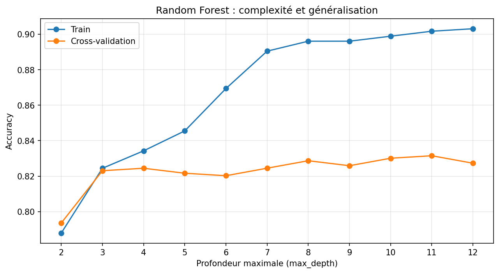
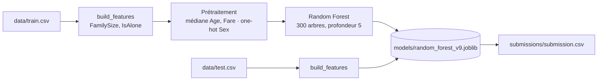

<div align="center">

# Titanic ML

**Prédire qui survit au naufrage du Titanic, de l'exploration des données jusqu'à un pipeline reproductible et testé.**

Exploration · feature engineering · régression logistique · Random Forest · validation croisée imbriquée

[](https://github.com/nolancolin/TitanicML/actions/workflows/tests.yml)




</div>

## Le projet

La compétition Kaggle [Titanic](https://www.kaggle.com/competitions/titanic) donne 891 passagers dont on
connaît le sort, et 418 autres dont il faut deviner s'ils ont survécu. C'est le problème de classification
classique pour débuter, et c'est justement pour ça que je l'ai pris : on peut se concentrer sur la méthode.

Le travail s'est fait version par version dans un notebook, de V1 (régression logistique sur trois variables)
à V13. Le modèle retenu, une Random Forest (V9), a ensuite été sorti du notebook dans des scripts
d'entraînement et de prédiction, avec des tests.

Ce qui m'a le plus appris :

- **Treize versions comparées honnêtement.** Chaque expérience reste dans le notebook avec son résultat,
  même quand elle n'apporte rien. La plupart n'apportent rien, et c'est une information.
- **Un écart CV / Kaggle expliqué.** Les modèles les mieux notés en validation croisée sont les moins bons
  sur Kaggle. La validation croisée imbriquée montre pourquoi (voir [Les limites](#les-limites)).
- **Aucune fuite de données.** L'imputation et l'encodage vivent dans les pipelines scikit-learn, donc
  chaque fold n'apprend que sur ses propres données d'entraînement.
- **Reproductible à l'octet près.** Versions épinglées, graines fixées : `src/predict.py` produit exactement
  la même soumission que le notebook.

## Résultats

| Soumission | Modèle | Score CV | Score Kaggle |
|---|---|---|---|
| V8 | Régression logistique, `FamilySize`, `IsAlone`, `Fare` | 79,50 % (5 folds) | **0,77511** |
| **V9** | **Random Forest, 300 arbres, profondeur 5** | 82,16 % (5 folds) | **0,77511** |
| RF optimisée | Random Forest, profondeur 11 choisie par GridSearchCV | 82,72 % (CV imbriquée) | 0,76555 |
| V10 | Random Forest, profondeur 11, `FarePerPerson` | 83,38 % (5 folds × 3) | 0,76076 |

V9 est le modèle de référence : meilleur score Kaggle, à égalité avec V8, et nettement meilleur que la
régression logistique en validation croisée. Les scores CV ne viennent pas tous du même protocole, ils ne
se comparent donc pas directement entre eux.

## Essayer

Il faut Python 3.12 :

```bash
git clone https://github.com/nolancolin/TitanicML.git
cd TitanicML
python -m venv .venv
source .venv/bin/activate        # Windows : .venv\Scripts\activate
pip install -r requirements.txt
```

Entraîner le modèle puis générer la soumission Kaggle :

```bash
python -m src.train
python -m src.predict
```

```
Accuracy CV (5 folds) : 0.8249
Modèle enregistré : models/random_forest_v9.joblib
418 prédictions enregistrées dans submissions/submission.csv
```

| Option | Script | Effet |
|---|---|---|
| `--train data/train.csv` | `train` | données d'entraînement |
| `--model models/....joblib` | les deux | où enregistrer ou lire le modèle |
| `--test data/test.csv` | `predict` | passagers à prédire |
| `--output submissions/....csv` | `predict` | fichier de soumission |

Pour rejouer toutes les expériences, ouvrir [`titanic.ipynb`](titanic.ipynb) avec le kernel du `.venv`
puis *Restart Kernel → Run All*.

## Comment ça marche



### Les variables

| Variable | Origine | Rôle |
|---|---|---|
| `Sex` | brute, encodée en one-hot | de loin la plus importante |
| `Pclass` | brute | classe du billet, proxy du niveau social |
| `Age` | brute, 177 valeurs manquantes remplies par la médiane | les enfants survivent plus |
| `Fare` | brute, médiane si absente | prix du billet |
| `FamilySize` | `SibSp + Parch + 1` | taille du groupe familial à bord |
| `IsAlone` | `FamilySize == 1` | voyage seul ou non |

Tout est dans [`src/features.py`](src/features.py). Le notebook et les scripts importent les mêmes
fonctions, il n'y a qu'une seule version du feature engineering.

### Pourquoi une profondeur de 5

Le graphique en haut de page montre l'accuracy de la Random Forest selon la profondeur maximale des arbres.
En entraînement, elle grimpe jusqu'à 0,90 dès la profondeur 8 : le modèle apprend les passagers par cœur.
En validation croisée, elle reste entre 0,82 et 0,83 à partir de la profondeur 3. L'écart entre les deux
courbes s'ouvre après 5. La profondeur 11 gagne environ un point en CV, mais en perd un sur Kaggle
(0,775 → 0,766). La profondeur 5 généralise mieux.

<details>
<summary><b>Toutes les versions testées</b></summary>

| Version | Changement | Résultat | Protocole |
|---|---|---|---|
| V1 | Régression logistique : `Pclass`, `Age`, `Sex` | F1 0,724 | 5 folds |
| V2 | + `SibSp` | F1 0,718 | 5 folds |
| V3 | + `Parch` | F1 0,714 | 5 folds |
| V4 | + `Fare` | F1 0,721 | 5 folds |
| V5 | `FamilySize` à la place de `SibSp` et `Parch` | F1 0,714 | 5 folds |
| V6 | `SibSp` et `Parch` ensemble | F1 0,712 | 5 folds |
| V7 | `IsAlone` | F1 0,718 | 5 folds |
| V8 | `FamilySize`, `IsAlone`, `Fare` | accuracy 79,50 % | 5 folds |
| V9 | Random Forest, profondeur 5 | accuracy 82,16 % | 5 folds |
| | Random Forest, profondeur 11 | 83,05 % | 5 folds × 3 |
| | + titre extrait du nom | −0,05 point | 5 folds × 3 |
| | + indicateur de valeurs manquantes | 82,16 % | 5 folds × 3 |
| | Gradient Boosting | 83,29 % | 5 folds × 3 |
| | XGBoost | 83,10 % | 5 folds × 3 |
| | GridSearchCV sur la profondeur | 82,72 % | CV imbriquée |
| V10 | + `FarePerPerson` | 83,38 % | 5 folds × 3 |
| V11 | + `Embarked` | 82,82 % | 5 folds × 3 |
| V12 | Gradient Boosting sur les variables de V10 | 82,44 % | 5 folds × 3 |
| | + taille du groupe de billet (`TicketCount`) | 83,62 % | 5 folds × 3 |
| V13 | Régression logistique + `IsChild`, `Sex × Pclass` | 78,70 % (V8 : 79,59 %) | 5 folds × 3 |

L'écart-type tourne autour de 2 points. Presque toutes ces différences sont donc dans le bruit.

</details>

## Ce que disent les données

- **Le sexe décide presque tout.** 74 % des femmes survivent contre 19 % des hommes. Quand on mélange
  la colonne `Sex`, la Random Forest perd 0,20 d'accuracy. Pour `Pclass`, la deuxième variable, c'est 0,04.
- **Le titre ne dit rien de plus.** Les « Mr » survivent à 15 %, les « Mrs » à 79 %, les « Master » (garçons)
  à 55 %. Mais le sexe et l'âge contiennent déjà cette information, et l'ajouter ne change pas le score.
- **`IsAlone` est redondant.** Il se déduit de `FamilySize`, et la Random Forest obtient exactement le même
  score avec ou sans lui.
- **Partager son billet aide.** Parmi les passagers sans famille à bord, ceux qui partagent leur billet avec
  quelqu'un survivent à 54 %, contre 27 % pour les autres.

## Les limites

- **Le choix de modèle sur-apprend les folds.** Profondeur, variables et algorithme ont été choisis en
  regardant les mêmes splits que ceux qui les notent. La CV monte (83,4 % pour V10) pendant que Kaggle
  descend (0,761). La validation imbriquée donne une estimation plus honnête (82,7 %), et un jeu de test
  jamais regardé aurait été encore mieux.
- **Peu de données, beaucoup de bruit.** Avec 891 passagers, un écart de moins d'un point ne veut rien dire.
- **`TicketCount` est bancal.** Au `fit`, chaque passager se compte dans son groupe ; au `transform`, seuls
  les passagers vus pendant le `fit` sont comptés. La variable n'a donc pas le même sens à l'entraînement et
  à la prédiction. L'expérience est gardée telle quelle et documentée dans le notebook.

## Tests

```bash
python -m pytest
```

- **Données** : dimensions et colonnes des fichiers Kaggle.
- **Feature engineering** : colonnes produites, calcul de `FamilySize` et `IsAlone`, données d'entrée non modifiées.
- **Prétraitement** : plus aucune valeur manquante après le pipeline, sur l'entraînement comme sur le test.
- **Soumission** : de bout en bout, entraînement puis prédiction, avec le format attendu par Kaggle
  (418 lignes, `PassengerId` et `Survived` à 0 ou 1).

Les tests tournent sur GitHub Actions à chaque push.

## Organisation du code

```
src/
├── features.py     variables du modèle et prétraitement
├── train.py        entraîne la Random Forest V9 et l'enregistre
└── predict.py      génère la soumission Kaggle
tests/              tests des données, des variables et de la soumission
data/               train.csv et test.csv de Kaggle
docs/               graphique du README, produit par le notebook
titanic.ipynb       toutes les expériences, de V1 à V13
```

## Pistes pour la suite

- Garder un **jeu de test jamais regardé** pour mesurer le vrai coût du choix de modèle.
- Compter les **billets partagés sur train + test** avec une validation croisée adaptée.
- Essayer un **vote entre modèles** (régression logistique, Random Forest, Gradient Boosting), qui se
  trompent sur des passagers différents.
- Ajuster le **seuil de décision** plutôt que de garder 0,5 par défaut.

## Auteur

Projet réalisé par [Nolan](https://github.com/nolancolin), 2026.
